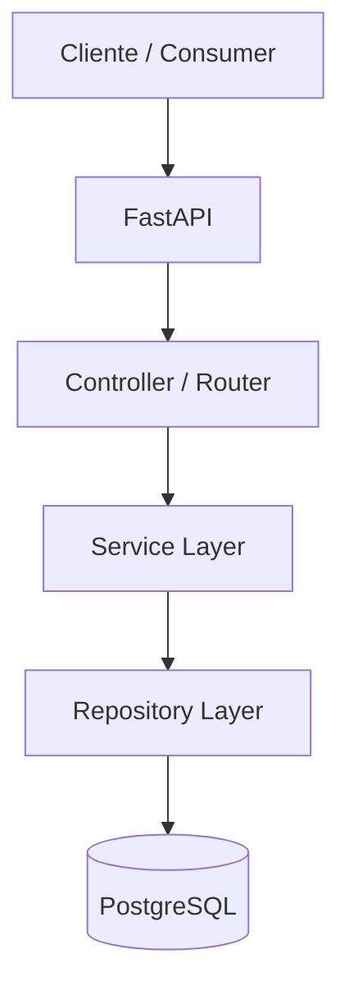
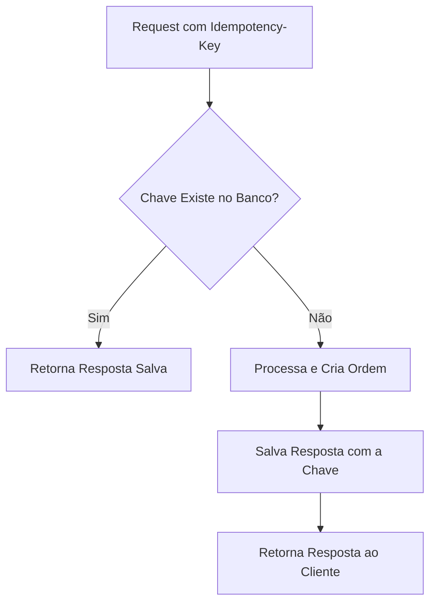
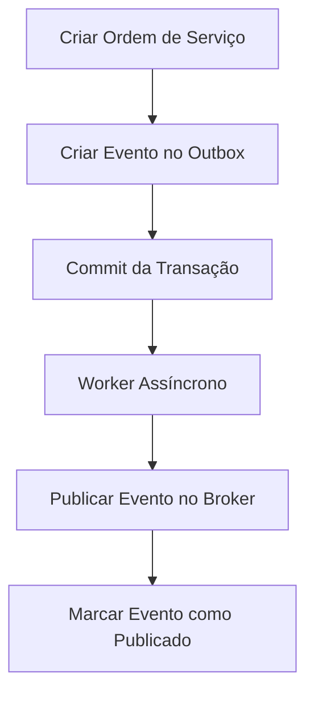
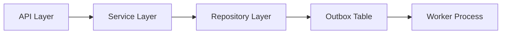

# API Ordem de Serviço

API REST para criação e gestão de Ordens de Serviço, desenvolvida utilizando princípios de arquitetura moderna, resiliência, consistência e observabilidade.

---

## 🏗 Arquitetura



---

## 🚀 Configuração do Ambiente

### 1. Clonar o Repositório
```bash
git clone <url-do-repositorio>
cd os-api
```

### 2. Criar e Ativar o Ambiente Virtual
* **Windows (PowerShell):**
  ```powershell
  python -m venv .venv
  .\.venv\Scripts\activate
  ```
* **Linux / macOS:**
  ```bash
  python3 -m venv .venv
  source .venv/bin/activate
  ```

### 3. Instalar Dependências
```bash
pip install -r requirements.txt
```

### 4. Subir o Banco de Dados (PostgreSQL)
```bash
docker compose up -d
```
Para verificar se o container está rodando:
```bash
docker ps
```

### 5. Executar as Migrations
```bash
alembic upgrade head
```

### 6. Executar a Aplicação
```bash
uvicorn src.main:app --reload
```

---

## 📖 Documentação & Endpoints

### Swagger UI
Acesse a documentação interativa em: `http://127.0.0.1:8000/docs`

---

### Health Check
Verifica a disponibilidade da aplicação.

* **Endpoint:** `GET /health`
* **Response (200 OK):**
  ```json
  {
    "status": "healthy"
  }
  ```

---

### Criar Ordem de Serviço
Cria uma nova ordem de serviço no sistema.

* **Endpoint:** `POST /ordens-servico`
* **Headers:**
  | Header | Tipo | Descrição |
  | :--- | :--- | :--- |
  | `Idempotency-Key` | String | Chave única para controle de idempotência |
  | `X-Correlation-Id` | String (UUID) | Identificador para rastreabilidade de logs |

* **Request Body:**
  ```json
  {
    "solicitante_id": "123",
    "descricao": "Troca de equipamento"
  }
  ```

* **Response (201 Created):**
  ```json
  {
    "id": "550e8400-e29b-41d4-a716-446655440000",
    "solicitante_id": "123",
    "descricao": "Troca de equipamento",
    "status": "CRIADA"
  }
  ```

---

### ⚠️ Validação de Solicitante
Antes da criação da Ordem de Serviço, o sistema valida a existência do solicitante através de um serviço externo (atualmente implementado como *Fake Client*).

* **Solicitantes válidos para teste:** `123`, `456`, `789`.

---

### ❌ Tratamento de Erros (Problem Details)
Os erros da API seguem o padrão da **RFC 7807**.

**Exemplo de erro (404 Not Found):**
```json
{
  "type": "/errors/not-found",
  "title": "Solicitante não encontrado",
  "status": 404,
  "detail": "O solicitante informado não existe"
}
```

---

## 🔁 Idempotência

A API implementa controle de idempotência via header `Idempotency-Key` para evitar a criação duplicada de ordens em cenários de *retry*.

### Fluxo de Execução


---

## 📬 Outbox Pattern

Para garantir a consistência transacional ao notificar outros sistemas, o **Outbox Pattern** é utilizado. A criação da Ordem de Serviço e do registro do evento ocorrem dentro da **mesma transação do banco de dados**.

### Fluxo do Outbox


### Estrutura do Evento
```json
{
  "event_type": "ORDEM_SERVICO_CRIADA",
  "payload": {
    "id": "550e8400-e29b-41d4-a716-446655440000",
    "solicitante_id": "123"
  }
}
```

### Status do Evento no Banco
* **Antes do envio:** `published = false`
* **Após envio:** `published = true`

---

## 🔍 Observabilidade & Logs

### Correlation ID
Cada requisição aceita ou gera um `X-Correlation-Id` que é propagado em todas as camadas da aplicação para rastreabilidade ponta a ponta.



**Exemplo de Log Formated:**
```text
[b86124ad-b7cc-4bc6-a9ae-d7729d7410d4] INFO - Ordem de Serviço criada com sucesso.
```

---

## 🗄️ Banco de Dados

Tabelas principais gerenciadas pelo **Alembic**:
* `ordens_servico`
* `idempotency_keys`
* `outbox_events`
* `alembic_version`

---

## 🧪 Testes

### Executar a suíte de testes completa
```bash
pytest -v
```

### Escopo de Cobertura
* **Testes Unitários:**
  * Service Layer
  * Regras de Idempotência
  * Validação de Solicitante Inválido
  * Health Check
* **Testes de Integração:**
  * Endpoint de Criação de Ordem
  * Respostas em Padrão RFC 7807 (Problem Details)
  * Validação prática do header `Idempotency-Key`
  * Propagação do `X-Correlation-Id`

---

## 📐 Decisões Arquiteturais

* **Repository Pattern:** Desacopla as regras de negócio da camada de acesso a dados, facilitando a criação de testes e mocks.
* **Idempotência:** Protege o sistema contra duplicidade de dados causada por instabilidades de rede e retries dos clientes.
* **Outbox Pattern:** Assegura *eventual consistency* e evita o problema de *dual-write* sem depender de transações distribuídas pesadas.
* **Correlation ID:** Permite rastrear requisições em ambientes distribuídos e centralizadores de log.

---

## 🗺️ Roadmap de Evolução

- [ ] Autenticação via JWT
- [ ] Mecanismo de Retry com Exponential Backoff no Worker
- [ ] Implementação de Dead Letter Queue (DLQ)
- [ ] Integração com Apache Kafka / RabbitMQ
- [ ] Dashboard de Métricas e Dashboards com Grafana & Prometheus